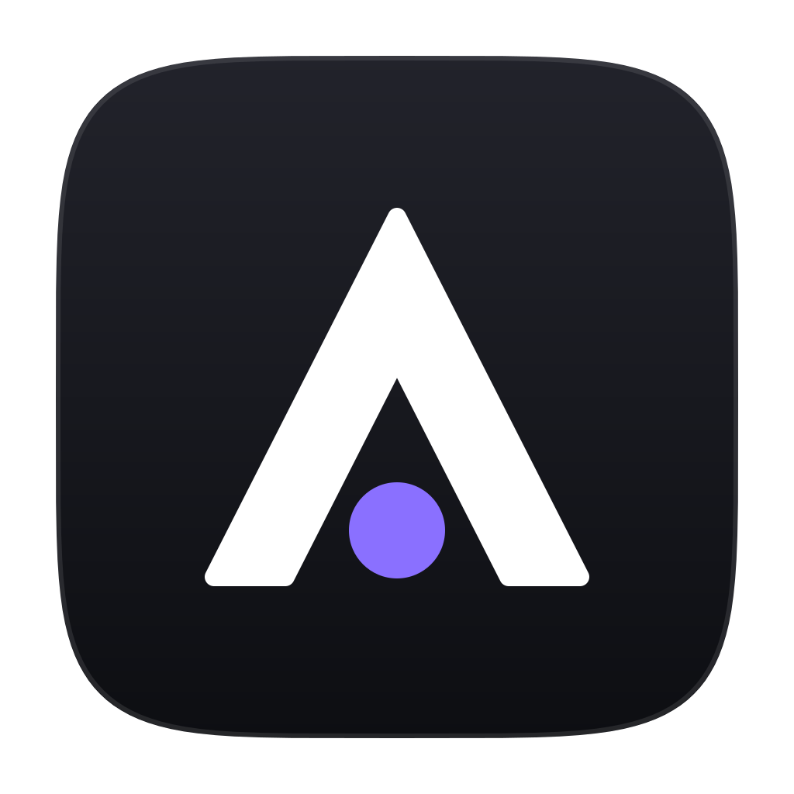
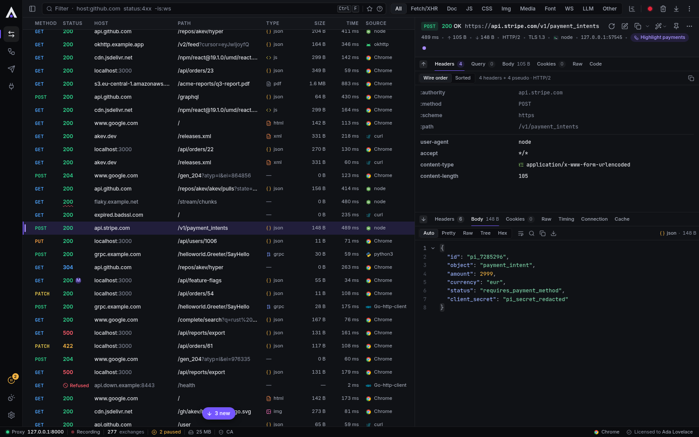
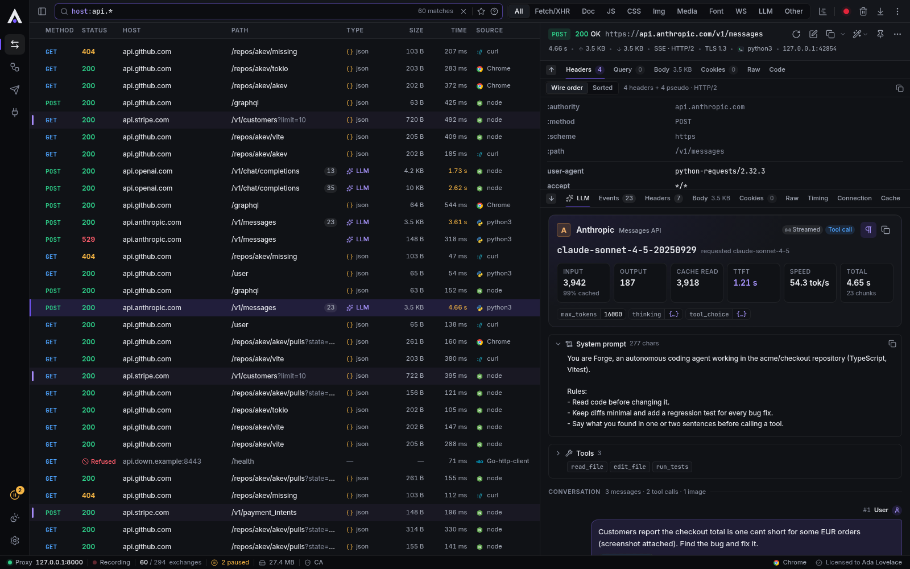
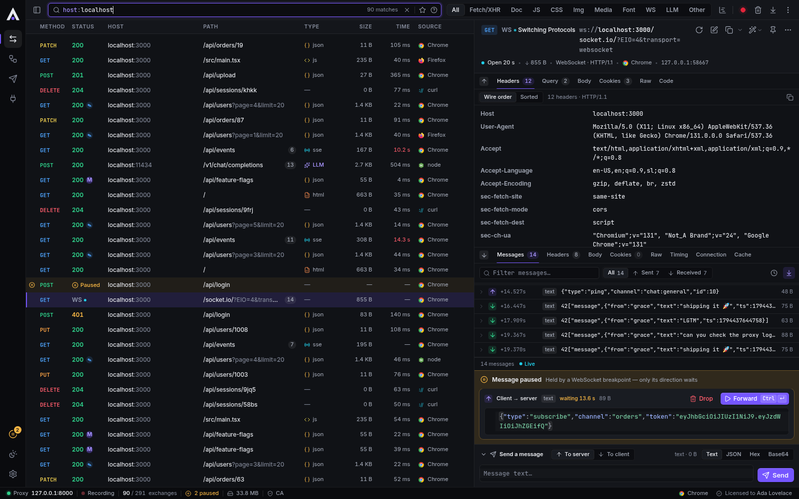
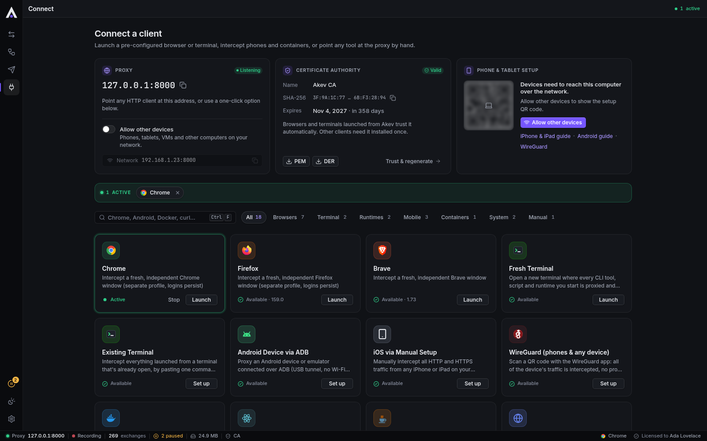
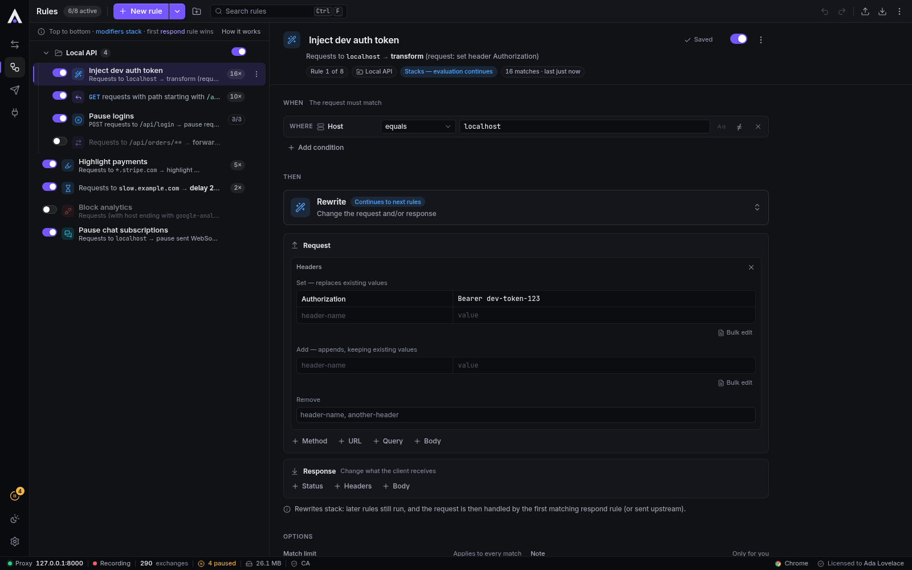

<p align="center">
  
</p>

<h1 align="center">Akev</h1>

<p align="center">
  <b>Intercept, inspect, mock and debug HTTP(S) traffic — fast, light, and free.</b><br>
  A modern, open-source alternative to HTTP Toolkit, Charles and Proxyman. Written in Rust.<br>
  <a href="https://akev.dev">akev.dev</a>
</p>

<p align="center">
  
</p>

---

Akev is a debugging proxy for developers, testers and security engineers. Launch a browser,
terminal, Android device or container with one click and every request it makes shows up
instantly — headers, bodies, timings, TLS details and the app that sent it. Then change
anything: mock responses, rewrite requests, map to local files, throttle the network, pause at
breakpoints, or script it in JavaScript.

### Why Akev

- **Fast, small, bounded.** A single Rust process with the UI embedded, no Electron. Measured
  on a busy 2015 quad-core desktop: ~17k req/s (p99 14 ms) through the full capture pipeline,
  100k exchanges in ~360 MB, and long sessions level off at the default cap of 200,000
  exchanges ([numbers and method](docs/PERFORMANCE.md)). Captured bodies spill to disk past a
  memory budget, the UI is virtualised and filtering runs in Rust.
- **Bit-exact traffic.** A custom HTTP/1 codec preserves header case, order and duplicates in
  both directions, paths are never normalised, and replays send exactly what you see.
- **Free where others charge.** Mocking, rewriting, breakpoints, rules that persist, HAR/session
  import & export, Compose and replay, code snippets, upstream proxies, themes, settings — free,
  with no account and no telemetry (the only request Akev makes on its own is an optional
  daily update check). [Akev Pro](https://akev.dev/pricing/) ($49 once, no
  subscription) adds scripting, TLS impersonation, WireGuard, transparent capture, JVM attach,
  protobuf schemas, the LLM lens and MCP write tools; licence keys are checked offline.
- **One-click interception** for Chrome, Brave, Edge, Firefox and other browsers, new or existing
  terminals (Node, Python, Ruby, Go, Rust, Java, curl, git… via env vars & CA bundles),
  Android over ADB (system-wide trust on rooted devices and emulators), the iOS Simulator,
  Docker, Electron apps, the OS-wide system proxy (with crash-safe restore), and any device via
  a setup page with QR code.
- **One-click CA trust.** Akev shows whether this computer trusts its certificate and adds it
  to the macOS keychain, the Windows certificate store or the Linux system store (and
  Chrome's) when you click Trust; the system asks you to confirm, and Remove undoes it.
- **WireGuard mode for phones.** Scan one QR code with the official WireGuard app (iOS, Android,
  macOS, Windows, Linux) and *all* of the device's traffic flows through Akev — every app, no
  proxy settings. An embedded userspace WireGuard server (no root) terminates each TCP
  connection and hands it to the proxy with its original destination.
- **Transparent capture (Linux)** for apps that ignore proxy settings: the kernel redirects
  their connections to Akev, per app (cgroup v2), per user or machine-wide. Akev generates
  the nftables / iptables commands and shows when redirected traffic arrives — it never runs
  root commands itself.
- **Attach to running JVMs — no restart.** Pick a running Java, Kotlin or Scala app and Akev
  loads a small Java agent into it: its HTTP clients (HttpURLConnection, java.net.http, and
  OkHttp/Apache/Netty clients created afterwards) go through the proxy and trust the Akev CA
  alongside the JVM's own roots. One click restores its original settings
  ([guide](https://akev.dev/docs/jvm/)).
- **Powerful rules.** Matchers for method, host, path, URL, query, headers, cookies, body, JSON,
  forms, GraphQL operation, source process and more — stackable modifiers (rewrite, delay,
  throttle, breakpoint, highlight, script, TLS fingerprint) plus terminal actions (mock, map local, map remote,
  passthrough, close/reset/timeout). Live hit counters, undo/redo, HTTP Toolkit rule import.
- **Deep inspection.** HTTP/1.1, HTTP/2, WebSockets and SSE as live message streams, gRPC,
  gRPC-Web, protobuf (with field names from imported `.proto` files or descriptor sets),
  MessagePack and CBOR decoding, JWT decoding, image/HTML/Markdown previews,
  hex viewer, timing waterfall, client TLS fingerprints (JA3/JA4), upstream certificates,
  cache analysis, and the process that made each request.
- **Look like a browser upstream.** Optional TLS fingerprint impersonation: Akev's own
  connections can present Chrome's, Firefox's, Safari's or Edge's ClientHello (JA3/JA4) and
  HTTP/2 preface — globally, per host, per rule, or mirroring the intercepted browser — so sites
  behind Cloudflare or Datadome stop blocking proxied traffic. Every exchange shows the
  fingerprint actually sent. Included in every official build (BoringSSL).
- **LLM traffic lens.** Calls to OpenAI, Anthropic, Gemini, Amazon Bedrock, Ollama and any
  OpenAI-compatible API show up as a conversation instead of raw JSON: system prompt, messages, tool calls and
  results, thinking, images, and the streamed reply reassembled — with token usage (cache and
  reasoning included), time to first token and tokens/s. Filter with `is:llm`, `model:`,
  `provider:`; agents get it over MCP too.
- **HTTP/3.** Akev talks HTTP/3 over QUIC to servers that advertise it (`Alt-Svc`), to every
  HTTPS server, or per Compose request — falling back to TCP when QUIC fails — and can accept
  HTTP/3 from clients on a QUIC listener, recording those exchanges as HTTP/3 through the same
  rules, breakpoints and inspection.
- **Compose & replay** with tabs, history, saved requests, cURL paste, an HTTP version choice
  (HTTP/1.1, HTTP/2, HTTP/3), and code export to 20 languages. Import HAR, Charles, mitmproxy
  and Fiddler (`.saz`) captures; double-click a `.har` or `.akev` file to open it.
- **Built for automation.** A token-secured REST/WebSocket API, `akev capture -- npm test`
  for CI (runs your tests through the proxy and writes a HAR), and a built-in **MCP server**
  so AI coding agents can inspect and mock traffic, with secrets redacted and file access
  confined by default.
- **Safe on a network.** Proxy access is limited to this machine and private networks by
  default, with optional credentials and a block list; the API is served over HTTPS to other
  machines. Exports can redact tokens, cookies and keys.

## Screenshots

| LLM traffic lens | Live WebSocket messages |
|---|---|
|  |  |

| One-click connect | Rules editor |
|---|---|
|  |  |

## Install

Download from [Releases](https://github.com/akevdev/akev/releases). `SHA256SUMS` lists every
file's checksum; it is signed with Sigstore (`cosign verify-blob --bundle SHA256SUMS.sigstore.json
--certificate-identity-regexp 'github.com/akevdev/akev' --certificate-oidc-issuer
https://token.actions.githubusercontent.com SHA256SUMS`).

| Platform | Get it |
|---|---|
| macOS (Apple Silicon & Intel) | `Akev_<version>_universal.dmg` |
| Windows 10/11 (x64, Arm64) | `Akev_<version>_x64-setup.exe` / `_arm64-setup.exe`, or `.msi` |
| Linux (x64, Arm64) | `.AppImage`, `.deb` or `.rpm` |
| Command line only | `akev-<version>-<platform>.tar.gz` / `.zip` |
| Docker (headless, amd64 and arm64) | `docker run -v akev-data:/data -p 127.0.0.1:8000:8000 -p 127.0.0.1:45456:45456 -e AKEV_TOKEN="$(openssl rand -hex 24)" ghcr.io/akevdev/akev` |

With a package manager:

```sh
# Homebrew (macOS and Linux): the command line, and the macOS app
brew install akevdev/tap/akev
brew install --cask akevdev/tap/akev-desktop

# Scoop (Windows): the command line
scoop bucket add akev https://github.com/akevdev/scoop-bucket
scoop install akev/akev
```

The macOS app isn't notarized by Apple yet, so macOS asks before the first launch: open Akev
once, then click **Open Anyway** in System Settings → Privacy & Security.

Building from source: `make ui && cargo install --path crates/akev-cli` (add
`--features impersonate` for TLS fingerprint impersonation; needs cmake and clang).

Maintainers: see [docs/RELEASING.md](docs/RELEASING.md).

## Quick start

```bash
akev                 # starts the proxy on :8000 and opens the UI in your browser
```

1. Open **Connect** and click a client (e.g. Chrome or *New terminal*).
2. Use it — requests stream into **Traffic**.
3. Right-click any request → *Create rule → Mock this response*, or *Edit in Compose*.

Headless capture for CI:

```bash
# Runs the tests through the proxy (proxy and CA variables set), writes the HAR when they
# finish, and exits with their status.
akev capture --output traffic.har -- npm test
```

Each capture uses a fresh CA: `--ca-out ca.pem` writes it for clients started another way.

## Documentation

The user guides and the HTTP API reference live on the website, [akev.dev/docs](https://akev.dev/docs/):

- [Getting started](https://akev.dev/docs/getting-started/)
- [Filter language](https://akev.dev/docs/filters/)
- [Rules](https://akev.dev/docs/rules/) and [scripting](https://akev.dev/docs/scripting/)
- [Intercepting running JVMs](https://akev.dev/docs/jvm/): attach to Java, Kotlin and Scala apps without a restart
- [Protobuf & gRPC schemas](https://akev.dev/docs/protobuf/)
- [WebSockets](https://akev.dev/docs/websockets/): sending messages and message breakpoints
- [HTTP/3](https://akev.dev/docs/http3/): QUIC to servers (Alt-Svc / prefer / per request) and the QUIC listener
- [LLM traffic lens](https://akev.dev/docs/llm/): OpenAI, Anthropic, Gemini and Ollama calls as conversations
- [Upstream TLS fingerprints](https://akev.dev/docs/tls-impersonation/): impersonating Chrome, Firefox, Safari and Edge
- [CLI reference](https://akev.dev/docs/cli/) and [MCP for AI agents](https://akev.dev/docs/mcp/)
- [Sessions, autosave and Charles / mitmproxy import](https://akev.dev/docs/sessions/)
- [WireGuard mode](https://akev.dev/docs/wireguard/): intercept a whole phone with one QR code
- [Transparent capture (Linux)](https://akev.dev/docs/transparent/): per-app, per-user or machine-wide redirect rules
- [HTTP API](https://akev.dev/docs/api/): the token-secured REST and WebSocket API

For contributors: [ARCHITECTURE.md](docs/ARCHITECTURE.md), the UI design system in
[DESIGN.md](docs/DESIGN.md), [TESTING.md](docs/TESTING.md) and [RELEASING.md](docs/RELEASING.md).

## Building from source

Requirements: Rust (stable), [Bun](https://bun.sh), and for the desktop app the
[Tauri prerequisites](https://v2.tauri.app/start/prerequisites/) (webkit2gtk-4.1 on Linux).

```bash
make ui          # build the web UI (embedded into the binaries)
make release     # target/release/akev
make release-impersonate  # …with browser TLS fingerprints (BoringSSL; needs cmake + clang)
make desktop     # desktop bundles via Tauri
make dev         # daemon + UI dev server with hot reload
make test        # Rust tests + UI type checks
```

## License

AGPL-3.0-or-later. Akev Pro features are part of this source; the licence check runs offline
(see [akev.dev/docs/licensing](https://akev.dev/docs/licensing/)). Buying Pro is how the project
is funded. Akev is an independent project and is not affiliated with HTTP Toolkit; its cache
analysis and forgiving JSON formatter are adapted from
[HTTP Toolkit's UI](https://github.com/httptoolkit/httptoolkit-ui) (Tim Perry,
AGPL-3.0-or-later).
